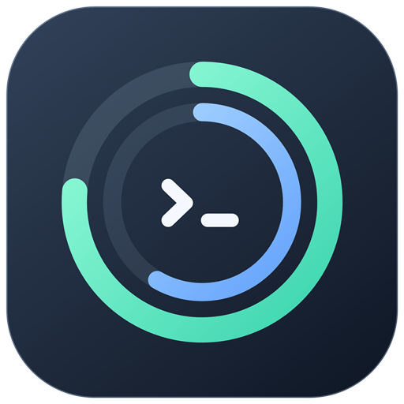
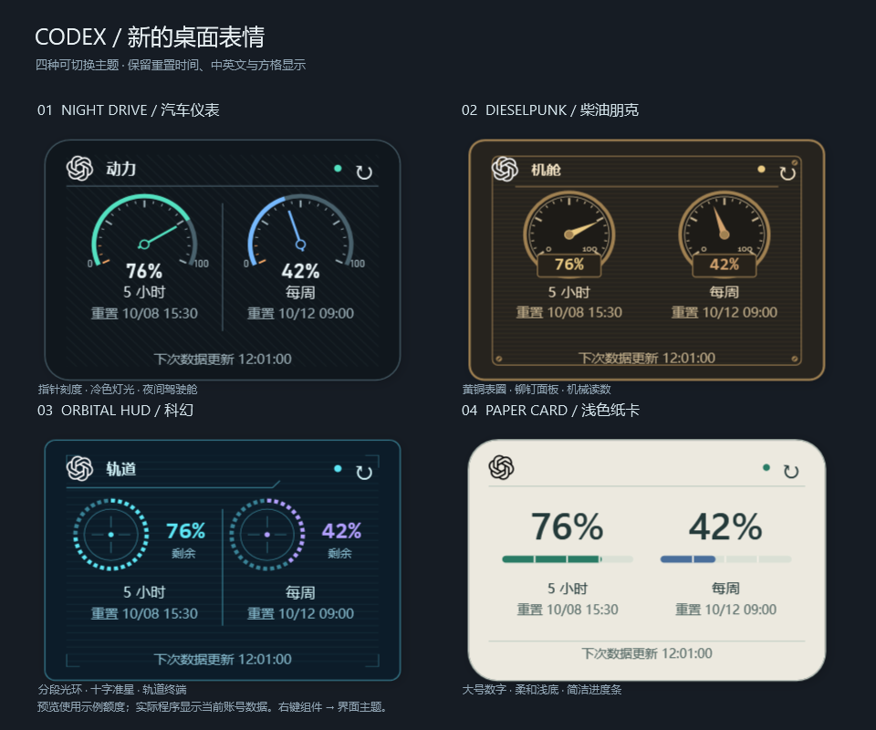
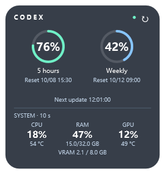

# Codex Quota Widget



轻量 Windows 桌面额度组件。使用本机 Codex CLI 的官方 app-server 接口，显示当前 ChatGPT 账号的 Codex 短期和每周剩余额度。

## 功能

- 可关闭的性能面板：CPU 占用、物理内存用量、第一张 NVIDIA 显卡的占用/温度/显存；联想 GameZone 固件支持时可读取 CPU 温度。
- 性能默认每 10 秒更新，可选 5 / 10 / 30 秒；温度和 GPU 最快每 10 秒采样。隐藏、最小化或关闭面板即暂停；电池供电时暂停独显查询。
- 半透明圆角卡片，可在双环和 GitHub 贡献图风格的方格之间切换。方格用 50 格表示当前额度百分比，不是每日历史记录。
- 五种界面主题：经典玻璃、汽车仪表、柴油朋克、科幻 HUD、浅色纸卡。每种主题均可配合方格显示，自动记住选择。
- 直接显示短期与每周额度的重置时间，以及下次数据更新的当地时间。
- 支持中文和英语界面，语言及样式选择自动保存。
- 默认每 60 秒刷新，支持手动刷新、拖动、置顶和托盘隐藏。
- 鼠标悬停额度环可查看重置时间；右键可调整透明度和自启。
- 网络故障自动重连并逐步延长重试间隔；旧数据会明确标记。
- 不调用模型，不创建对话，不需要另填 API Key。

## 下载和运行

从本仓库 [Releases](../../releases/latest) 下载 `CodexQuota-v1.3.1-windows.zip`，完整解压到有写入权限的固定目录。

运行环境：Windows 10/11、.NET Framework 4.7.2 或更新版本，以及已安装并使用 ChatGPT 账号登录的 Codex CLI。程序优先查找当前用户 npm 全局安装的 CLI，其次查找 PATH 中的 `codex.exe`。

1. 在终端确认 `codex --version` 可用，并通过 `codex login` 完成登录。
2. 双击 `CodexQuota.exe` 启动；也可双击 `Start.vbs` 创建桌面快捷方式并启动。
3. 首次启动默认启用当前用户登录 Windows 后自启，可在组件右键菜单中关闭。自启快捷方式位于当前用户的 Windows 启动文件夹。

请保留解压目录，快捷方式会引用其中的程序和图标。程序未进行代码签名。

## 使用

| 操作 | 效果 |
| --- | --- |
| 拖动卡片 | 移动并记住位置 |
| 点击右上角 ↻ 或双击卡片 | 立即刷新 |
| 悬停额度环 | 查看该额度的重置时间 |
| 右键卡片 → 语言 | 中文 / English |
| 右键卡片 → 界面主题 / Theme | 五种主题，立即切换并保存 |
| 右键卡片 → 性能监控 / Performance monitoring | 显示开关、采样间隔、CPU 温度授权 |
| 右键卡片 → 显示样式 | 主题仪表或圆环 / 方格 |
| 右键卡片 | 连接详情、透明度、置顶、自启、隐藏、退出 |
| 再次运行程序或双击托盘图标 | 唤回已有窗口 |

“剩余百分比”是 `100 - usedPercent`，不是 token 数量。缺失额度显示为“—”；查询失败时不推算或伪造新额度。数据以 CLI 当前登录账号为准，服务端可能有延迟。

## 主题预览



上图使用示例额度，不是某个账号的数据。汽车仪表使用指针、刻度与夜间灯光；柴油朋克使用黄铜表圈和铆钉；科幻 HUD 使用分段光环与准星；纸卡使用大号数字和进度条。主题均由矢量绘制，保持原来的 270 × 190 小窗口，不添加持续动画。浅色纸卡会提高背景覆盖度，保证深色文字在暗色壁纸上清晰。原有经典玻璃主题继续保留。

升级已有安装时，先在右键菜单退出程序，再将新版发布包解压覆盖原目录。保留原目录中的 `settings.json` 与本地数据即可继续使用原有语言、位置、透明度和自启设置。

## 性能监控与开销



此图是示例读数。实机未授权或未支持的 CPU 温度显示 —。

性能面板启用时窗口为 270 × 284，关闭后恢复 270 × 190。CPU 占用通过 Windows `GetSystemTimes` 的两次采样差值计算，内存通过 `GlobalMemoryStatusEx` 获取；CPU 首次采样或恢复监控时暂显示 —。CPU 占用是忙碌时间比例，可能与任务管理器的频率加权数值不同；超过 64 个逻辑处理器的机器只统计当前处理器组。

NVIDIA GPU 通过系统目录内驱动自带的 NVML 读取，不循环启动外部命令。首次初始化会加载驱动库；独显查询可能唤醒独显，因此电池供电时默认暂停 GPU 查询并释放 NVML。AMD / Intel 显卡暂不支持该温度接口，缺失项目显示 —，不会用 0 代替。显存为 NVML 报告的使用量。

CPU 温度优先使用联想新版 `LENOVO_OTHER_METHOD.GetFeatureValue` 的“CPU 当前温度”编号 `0x05040000`；不支持时回退 `LENOVO_GAMEZONE_DATA.GetCPUTemp`。成功后缓存接口，仅在查询失败时重新发现并退避重试。此编号不是可配置的温度限制。接口定义参考 [Lenovo Legion Toolkit](https://github.com/LenovoLegionToolkit-Team/LenovoLegionToolkit/blob/master/LenovoLegionToolkit.Lib/Enums.cs)。

若普通权限无法访问，可手动选择「授权 CPU 温度（Windows 管理员确认）」并由用户确认 Windows 提示。独立辅助进程只读取温度，不访问 Codex 账号、不安装驱动、不修改风扇/功耗设置，也不设为自启；退出组件时结束，下次启动需要重新授权。授权仍不能保证固件提供有效读数，其他品牌或未实现该接口时显示 —。悬停 CPU 温度可查看接口来源或失败状态。

采样在后台进行且不会重叠，不保存性能历史、不频繁写日志、不添加连续动画。开启性能面板时关闭整卡阴影效果，减少数值更新时的重绘。关闭面板、隐藏或最小化时停止采样；辅助进程保留但暂停查询，以免恢复时再次弹出授权。关闭辅助进程可在同一菜单操作。额度刷新仍为 60 秒，与性能采样分开。

验证包含原有 12 项检查、8 项硬件数值检查、5 项温度接口回退检查和 2 项普通权限辅助进程生命周期检查，以及 NVIDIA 实机读数、暂停恢复和电池模式检查。新版联想固件 CPU 温度已完成管理员授权后的实机读取、持续更新和界面显示验证；其他机型仍取决于固件是否提供有效读数。

接口参考：[Windows CPU 时间](https://learn.microsoft.com/en-us/windows/win32/api/processthreadsapi/nf-processthreadsapi-getsystemtimes)、[NVIDIA NVML](https://docs.nvidia.com/deploy/nvml-api/latest/api/group__nvmlDeviceQueries.html)。

## 网络和认证

使用持续运行的 `codex app-server`，通过 `account/rateLimits/read` 查询。认证交给官方 CLI；认证错误时请求 CLI 刷新登录。应用不读取、复制或保存认证令牌。

优先使用显式代理环境变量，否则读取 Windows 的手动 HTTP 代理设置。普通连接错误按 15、30、60、120、240、300 秒重试；HTTP 429 会延长等待。可在右键“额度与连接详情”查看脱敏后的错误信息。持续的网络故障、登录过期或服务端异常仍需要相应处理。

官方协议文档：[Codex App Server](https://learn.chatgpt.com/docs/app-server)。

## 从源码构建

无需第三方 NuGet 包；使用 Windows 自带的 .NET Framework C# 编译器。

```powershell
# 在仓库根目录运行，构建前先退出该目录中的组件
.\Build.ps1

# 运行错误分类、退避、额度解析和脱敏回归检查
.\tests\Test.ps1
```

`tools/MakeQuotaIcon.ps1` 可在 Windows PowerShell 5.1 中重新生成多尺寸 ICO 和 PNG 图标。

`tools/PreviewThemes.ps1 -OutputDirectory <目录>` 可离线生成实际界面的预览，覆盖中英文、主题仪表与方格、0% / 10% / 100% 和缺失额度。预览工具使用固定示例数据，不连接账号，不保存设置或修改自启。

## 本地数据

应用目录会生成 `settings.json`、`quota-cache.json`、`widget-status.json`、`widget.log` 和 `runtime/`。它们包含本地设置、额度缓存或运行状态，已列入 `.gitignore`，不随发布包上传。请勿手动提交这些文件。

五种主题、中英文、主题仪表及方格，以及额度边界值均经过离线渲染检查。1.1.0 已在 Windows 桌面验证圆环及方格布局、中文和英语切换、实际额度查询，以及重置时间和下次数据更新时间的显示。此前版本的网络失败后恢复、图标加载及自启入口也已验证；12 项回归检查通过。未通过重启电脑专门验证自启流程。

卸载前在右键菜单关闭自启，然后退出程序并删除应用目录与桌面快捷方式。

这是独立桌面工具，与 OpenAI 官方没有隶属关系。
